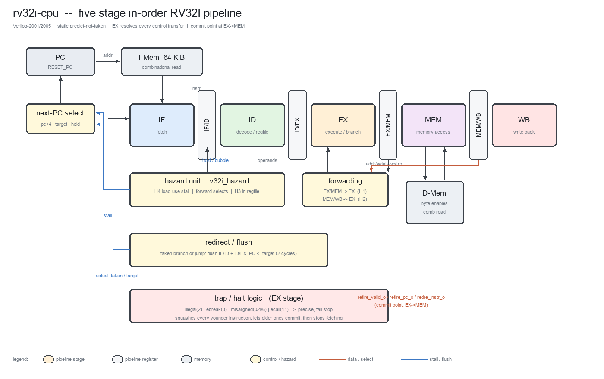

# 03 — 微架构规格书（Phase 3）

> 选定方案：**经典五级顺序单发射流水线**（IF / ID / EX / MEM / WB）
> 语言：**Verilog-2001/2005 可综合子集**（`.v`，不使用 SystemVerilog）
> 状态：待评审。本文档是 Phase 6 实现与 Phase 7 验证的唯一依据。

---

## 1. 顶层框图



*图 1：五级流水线框图（由 `tools/make_figures.py` 生成，可随设计变更重新生成）。*

```
                    ┌──────────────────────────────────────────────────────────┐
                    │                      rv32i_cpu (core)                    │
                    │                                                          │
   imem_addr[31:0]  │  ┌────┐  ┌──────┐  ┌──────┐  ┌──────┐  ┌──────┐           │
  ┌─────────────────┼──┤ IF ├─►│  ID  ├─►│  EX  ├─►│ MEM  ├─►│  WB  ├──┐        │
  │                 │  └────┘  └──────┘  └──────┘  └──────┘  └──────┘  │        │
  │  imem_rdata ────┼──►  pc   IF/ID    ID/EX    EX/MEM   MEM/WB       │        │
  │                 │    ▲     reg       reg       reg       reg        │        │
  │                 │    │                                              │        │
  │                 │  ┌─┴──────────┐   ┌───────────────┐   ┌──────────┴─────┐  │
  │                 │  │ next-PC    │◄──┤ 重定向/冲刷   │◄──┤  regfile 写口  │  │
  │                 │  │ 选择逻辑   │   │ (EX 级解析)   │   └────────────────┘  │
  │                 │  └─▲──────────┘   └───────▲───────┘                       │
  │                 │    │                      │                               │
  │                 │  ┌─┴────────┐   ┌─────────┴────────┐   ┌───────────────┐  │
  │                 │  │ 分支预测 │   │  冒险单元 hazard │   │  陷阱单元     │  │
  │                 │  │ (静态NT) │   │ 前递/互锁/停顿   │   │  (EX 级)      │  │
  │                 │  └──────────┘   └──────────────────┘   └───────────────┘  │
  │                 │                                                          │
  │                 │   dmem_addr/wdata/wstrb/we/re ──►        dmem_rdata ◄──   │
  └─────────────────┴──────────────────────────────────────────────────────────┘
        halt_i, trap_o, trap_cause_o, trap_pc_o, retire_*_o
```

五级职责（严格单向数据流，无反馈组合环）：

| 级 | 职责 | 组合逻辑 |
|---|---|---|
| IF | 取指、静态预测 | next-PC 选择、PC 加法、I-Mem 读 |
| ID | 译码、读寄存器堆、立即数生成、冒险判定 | decoder + immgen + regfile 读 + 冒险比较 |
| EX | 执行、分支/跳转解析、前递选择、访存地址生成 | 前递 Mux、ALU、分支比较器、目标加法 |
| MEM | 数据存储器访问、对齐与扩展、写回值选择 | D-Mem 读、字节/半字提取与符号扩展 |
| WB | 写回寄存器堆 | 无组合逻辑（写口直连 MEM/WB 寄存器） |

---

## 2. 流水线寄存器字段定义

所有流水线寄存器均为**同步复位**，复位值 `valid=0`（气泡），其余字段复位为 0。
`valid=0` 的气泡不产生任何体系结构副作用（不写寄存器、不写内存、不触发陷阱）。

### 2.1 IF/ID（98 bit）

| 字段 | 宽度 | 含义 |
|---|---|---|
| `if_id_valid` | 1 | 该槽位是否含有效指令 |
| `if_id_pc` | 32 | 取指 PC（分支预测目标、AUIPC/JAL 链接值的来源） |
| `if_id_instr` | 32 | 指令字 |
| `if_id_pred_taken` | 1 | IF 级静态预测结果（本版恒为 0） |
| `if_id_pred_target` | 32 | IF 级预测目标（本版为 don't-care） |

### 2.2 ID/EX（232 bit）

| 字段 | 宽度 | 含义 |
|---|---|---|
| `id_ex_valid` | 1 | 有效性 |
| `id_ex_ctrl` | 23 | 控制总线（§3） |
| `id_ex_pc` | 32 | 本指令 PC |
| `id_ex_instr` | 32 | 指令字（陷阱报告 + 退休观测） |
| `id_ex_rs1_val` | 32 | 寄存器堆读出的 rs1 原值 |
| `id_ex_rs2_val` | 32 | 寄存器堆读出的 rs2 原值 |
| `id_ex_imm` | 32 | 已生成的立即数 |
| `id_ex_rs1_addr` | 5 | rs1 号（前递比较用） |
| `id_ex_rs2_addr` | 5 | rs2 号（前递比较用） |
| `id_ex_rd_addr` | 5 | rd 号（写回/前递比较用） |
| `id_ex_pred_taken` | 1 | 预测结果传递到 EX 做对错判定 |
| `id_ex_pred_target` | 32 | 预测目标传递到 EX 做对错判定 |

### 2.3 EX/MEM（110 bit）

下游（MEM/WB）只需要控制字的一个子集，因此这里**不携带整条控制总线**，而是把需要的
字段做成命名的流水线寄存器：既省下 16 个触发器，也让 MEM 级不必再做位域映射
（该重构由 Verilator `UNUSEDSIGNAL` 提示触发，见 `07` §7 第 15 项）。

| 字段 | 宽度 | 含义 |
|---|---|---|
| `ex_mem_valid` | 1 | 有效性（同时是**提交点**标志，见 §7） |
| `ex_mem_rf_we` | 1 | 写寄存器堆 |
| `ex_mem_mem_re` | 1 | Load |
| `ex_mem_mem_we` | 1 | Store |
| `ex_mem_mem_size` | 2 | 访问宽度 |
| `ex_mem_mem_uns` | 1 | 零扩展载入 |
| `ex_mem_wb_sel` | 2 | 写回来源 |
| `ex_mem_pc` | 32 | 本指令 PC：**JAL/JALR 链接值 PC+4 在 MEM 级生成**，另供波形调试 |
| `ex_mem_alu` | 32 | ALU 结果（访存指令即**访存地址**） |
| `ex_mem_store_data` | 32 | 已前递修正的 store 数据 |
| `ex_mem_rd_addr` | 5 | rd 号 |

### 2.4 MEM/WB（39 bit）

| 字段 | 宽度 | 含义 |
|---|---|---|
| `mem_wb_valid` | 1 | 有效性 |
| `mem_wb_rf_we` | 1 | 写寄存器堆使能 |
| `mem_wb_wdata` | 32 | 最终写回数据（ALU / Load 数据 / PC+4 已在 MEM 选好） |
| `mem_wb_rd_addr` | 5 | rd 号 |

> 触发器总量（不含寄存器堆）：98 + 233 + 126 + 39 + 32(PC) + ~8(控制标志) ≈ **536 FF**。
> 寄存器堆 32×32 = 1024 FF（`RF_INIT_EN=1` 时带复位）。

---

## 3. 控制总线（23 bit 打包）

ID 级译码器输出**一条打包控制字**，随流水线传递；`valid=0` 时控制字全 0（气泡）。
字段位置在 `rtl/include/rv32i_defs.vh` 中以 `` `define `` 固化。

| 位域 | 名称 | 宽度 | 编码 |
|---|---|---|---|
| `[3:0]` | `CTRL_ALU_OP` | 4 | 见 §4 |
| `[4]` | `CTRL_ALU_A` | 1 | 0 = rs1，1 = PC（AUIPC） |
| `[5]` | `CTRL_ALU_B` | 1 | 0 = rs2，1 = imm |
| `[7:6]` | `CTRL_WB_SEL` | 2 | 0 = ALU，1 = Load 数据，2 = PC+4 |
| `[8]` | `CTRL_RF_WE` | 1 | 写寄存器堆 |
| `[9]` | `CTRL_MEM_RE` | 1 | Load |
| `[10]` | `CTRL_MEM_WE` | 1 | Store |
| `[12:11]` | `CTRL_MEM_SIZE` | 2 | 0 = byte，1 = half，2 = word |
| `[13]` | `CTRL_MEM_UNS` | 1 | Load 零扩展（LBU/LHU） |
| `[14]` | `CTRL_BRANCH` | 1 | 是条件分支 |
| `[17:15]` | `CTRL_BR_OP` | 3 | 分支 funct3（0,1,4,5,6,7） |
| `[18]` | `CTRL_JUMP` | 1 | JAL 或 JALR |
| `[19]` | `CTRL_JALR` | 1 | 目标来自 (rs1+imm)&~1，否则 PC+imm |
| `[20]` | `CTRL_ECALL` | 1 | ECALL |
| `[21]` | `CTRL_EBREAK` | 1 | EBREAK |
| `[22]` | `CTRL_ILLEGAL` | 1 | 非法指令（RV32I 未定义编码） |

`CTRL_W = 23`。FENCE/FENCE.I **没有专用控制位**：在单核、顺序、无 Cache 的机器上它
没有任何可观测效果，译码结果就是全 0 控制字（即 NOP），但仍占流水级并正常退休。

---

## 4. ALU 操作编码

| 编码 | 操作 | 说明 |
|---|---|---|
| 0 | ADD | 含地址生成、AUIPC |
| 1 | SUB | |
| 2 | SLL | 移位量取 `B[4:0]` |
| 3 | SLT | 有符号比较 |
| 4 | SLTU | 无符号比较 |
| 5 | XOR | |
| 6 | SRL | 逻辑右移 |
| 7 | SRA | 算术右移（`$signed`） |
| 8 | OR | |
| 9 | AND | |
| 10 | PASS_B | `Y = B`（LUI 专用） |

分支比较器独立于 ALU，与 ALU 共享**同一套前递后的操作数**，直接消费 funct3：

| `BR_OP` | 条件 | 有符号 |
|---|---|---|
| 0 | `A == B` | — |
| 1 | `A != B` | — |
| 4 | `A < B` | 是 |
| 5 | `A >= B` | 是 |
| 6 | `A < B` | 否 |
| 7 | `A >= B` | 否 |

---

## 5. 立即数生成

| 类型 | 指令 | 位拼接（Verilog） |
|---|---|---|
| I | ADDI/SLTI/SLTIU/XORI/ORI/ANDI/SLLI/SRLI/SRAI/LB..LHU/JALR | `{{20{instr[31]}}, instr[31:20]}` |
| S | SB/SH/SW | `{{20{instr[31]}}, instr[31:25], instr[11:7]}` |
| B | BEQ..BGEU | `{{19{instr[31]}}, instr[31], instr[7], instr[30:25], instr[11:8], 1'b0}` |
| U | LUI/AUIPC | `{instr[31:12], 12'b0}` |
| J | JAL | `{{11{instr[31]}}, instr[31], instr[19:12], instr[20], instr[30:21], 1'b0}` |

---

## 6. 冒险处理（完整且封闭的清单）

> 本节是整个流水线**唯一**的冒险来源，共 6 条。验证计划 `06` 对每一条都有对应用例。

### H1 — EX/MEM → EX 前递（RAW，距离 1）
条件：
```verilog
fwd_ex_mem_hit = ex_mem_valid & ex_mem_ctrl[`CTRL_RF_WE]
               & (ex_mem_rd_addr != 5'd0)
               & (ex_mem_rd_addr == id_ex_rs1_addr);   // 操作数 B 同理
```
数据源：`ex_mem_alu`。
**保护项**：`& ~ex_mem_ctrl[`CTRL_MEM_RE]`。Load 的数据在 EX/MEM 尚不存在（要等 MEM 级读
存储器），该情形由 H4 互锁保证不会发生；此项为防御性冗余。

### H2 — MEM/WB → EX 前递（RAW，距离 2）
条件：`mem_wb_valid & mem_wb_rf_we & (mem_wb_rd_addr != 0) & (mem_wb_rd_addr == id_ex_rs1_addr)`。
数据源：`mem_wb_wdata`（已是最终写回值，含 Load 数据）。
**优先级**：H1 > H2（EX/MEM 更新）。

### H3 — 寄存器堆写穿透（RAW，距离 3）
指令 C 在 ID 级同拍读寄存器堆，而生产者在 WB 级同拍写寄存器堆：
ID 读口在本拍得到的是**旧值**，且 C 下一拍进入 EX 时生产者已离开流水线，两条前递路径都
覆盖不到 —— 若不做处理就是**静默错值**。
处置：寄存器堆读口内建写穿透旁路
```verilog
rdata = (we & (waddr != 0) & (waddr == raddr)) ? wdata : rf[raddr];
```
（等价于教科书「前半拍写、后半拍读」，但用组合旁路实现，时序上更明确。）

### H4 — Load-Use 互锁（距离 1 的 Load）
```verilog
stall = id_ex_valid & id_ex_ctrl[`CTRL_MEM_RE] & (id_ex_rd_addr != 5'd0)
      & ( (if_id_uses_rs1 & (if_id_rs1_addr == id_ex_rd_addr))
        | (if_id_uses_rs2 & (if_id_rs2_addr == id_ex_rd_addr)) );
```
动作：PC 保持、IF/ID 保持、ID/EX 注入气泡（**1 拍**）。Load 的数据在下一拍经 H2 前递。
`if_id_uses_rs1/rs2` 由译码器按**指令真实用到的源操作数**给出，避免伪停顿
（例如 `lui` 不读 rs1、`jal` 不读任何寄存器）。

**实现说明（重要且已论证）**：译码器对 rs1/rs2/rd 做的是**裸字段提取**
（`instr[19:15]`、`instr[24:20]`、`instr[11:7]`），对 `lui/jal/auipc` 这类指令这些位
其实是立即数的一部分，因此寄存器号是"无意义"的。这不会造成错误，因为：
① 前递 Mux 的输出只在其对应控制位选中该操作数时才被消费（`lui` 走 `PASS_B`、
`auipc` 走 `PC`、`jal` 不消费操作数、I 型走立即数）；
② 写回/前递命中判定都被 `rf_we` 门控，而 S/B 型的 `rd` 字段虽是无意义位，其 `rf_we=0`；
③ 停顿判定被 `uses_rs1/uses_rs2` 门控。
该性质由 `tb_decoder`（裸字段契约）与 `tb_hazard`（有效位/写使能门控）显式测试。

### H5 — 控制冒险（分支/跳转，EX 级解析）
- 预测策略：**静态预测不跳转**（IF 恒取 `PC+4`），不实现任何预测器。
- 解析：EX 级算出 `actual_taken`、`actual_target`，与 `id_ex_pred_*` 比较：
```verilog
redirect = (actual_taken != id_ex_pred_taken)
         | (actual_taken & (actual_target != id_ex_pred_target));
```
- 动作：`PC ← actual_target`，IF/ID 与 ID/EX 清为气泡（**2 拍惩罚**）。
- 正确性保证：**始终以 EX 级算出的 `actual_target` 重定向**，即使 IF 预测目标算错也只会多冲刷，
  不会算错 PC。

### H6 — Store 数据冒险
Store 的 rs2 在 EX 级经 H1/H2 前递后写入 `ex_mem_store_data` 并随流水线带到 MEM 级。
因此 **MEM 级不需要第二套前递网络**。距离 3 的情形由 H3 覆盖。

### 6.1 停顿 / 冲刷控制表

| 事件 | 触发条件 | PC | IF/ID | ID/EX | EX/MEM | MEM/WB |
|---|---|---|---|---|---|---|
| 复位 | `reset` | `RESET_PC` | 气泡 | 气泡 | 气泡 | 气泡 |
| 停机 | `halt_i` | 保持 | 气泡 | 气泡 | **气泡** | 正常 |
| 陷阱 | `ex_trap` | 保持 | 气泡 | 气泡 | 正常 | 正常 |
| 重定向 | `redirect` | 目标 | 气泡 | 气泡 | 正常 | 正常 |
| Load-Use | `stall` | 保持 | 保持 | 气泡 | 正常 | 正常 |

优先级：`reset` > `halt_i`/`ex_trap` > `redirect` > `stall`。
注：`halt_i` 额外清空 EX/MEM —— 它来自 MEM 级（MMIO 停机），必须同时抹掉比 MEM 更年轻的
EX 级指令，否则该指令会在下一拍写内存。

---

## 7. 提交点、陷阱与停机

- **提交点（point of no return）= EX→MEM 边界**：本设计中 EX 是唯一可能产生陷阱的级，
  因此进入 EX/MEM 的指令**必然完成**。
- `retire_valid_o` 在 EX 级指令为有效且不触发陷阱时拉高一拍，并给出 `retire_pc_o/instr_o`。
- 陷阱在 **EX 级**统一产生（原因码见 `01` §5.1），动作：抹除比它年轻的指令（IF/ID、ID/EX），
  比它老的指令（EX/MEM、MEM/WB）继续正常提交；置位粘滞标志 `trap_o`，停止取指，直到复位。
- 同时输出 `trap_tval_o`，语义对齐 RISC-V 的 `mtval`：非法指令给出**指令编码**，非对齐访存
  给出**出错地址**，非对齐跳转给出**目标地址**，ECALL/EBREAK 为 0。
- **精确性**：触发指令不写寄存器、不写内存、不产生 MMIO 副作用。

---

## 8. 存储器接口时序

```
        ┌─────┐   ┌─────┐   ┌─────┐
 clk    ┘     └───┘     └───┘     └──
        [ MEM 级 周期 T ]  [ T+1 ]
 dmem_addr    <== 组合有效 ==>
 dmem_we/re   <== 组合有效 ==>
 dmem_wdata   <== 组合有效（lane 对齐）==>
 dmem_wstrb   <== 组合有效 ==>
 dmem_rdata   <== 同周期有效（组合读）==>   ↓ 在 T 上升沿被 MEM/WB 捕获
```

- 读：**零延迟**（组合读），数据在 MEM 级同拍有效。
- 写：**上升沿写入**，字节使能为唯一写控制。
- 未映射地址：读返回 0，写被忽略（由 SoC 保证；核心只发出请求）。
- 地址非对齐：EX 级即判陷阱（不产生存储器访问）。

---

## 9. 复位与确定性

| 项 | 行为 |
|---|---|
| 复位类型 | 同步、高有效（`reset`） |
| PC | `RESET_PC`（参数，默认 `32'h0000_0000`） |
| 全部流水线寄存器 | `valid=0`，其它字段全 0 |
| 寄存器堆 | 全 0（`RF_INIT_EN=1`，默认）；`x0` 硬连线读 0 |
| 陷阱标志 | 清 0 |
| 存储器 | 由外部镜像初始化（不属于 CPU 状态） |
| X 值 | 复位后所有体系结构状态确定；不存在由 X 决定的行为 |

---

## 10. 性能模型（解析 + 预期）

无结构冒险（I/D 端口独立），因此：

```
CPI = 1
    + 2 × f_ctrl_taken     （被采纳的分支 + 全部 JAL/JALR）
    + 1 × f_load_use       （Load 后紧接使用其结果的指令）
```

| 程序类型 | 实测 CPI | 说明 |
|---|---|---|
| 纯 ALU / 立即数密集（`isa_alu` / `isa_imm`） | **1.04 / 1.05** | 无控制转移 |
| 访存 + load-use（`isa_loadstore`） | **1.09** | 停顿按距离 1 计入 |
| 距离 3 依赖链（`hazard_wbthru`） | 1.10 | 写穿透不产生停顿 |
| 分支密集（`isa_branch`） | **1.66** | 每次采纳 +2 拍 |
| 跳转密集（`isa_jump`） | **1.59** | 每次 jal/jalr +2 拍 |

实测数据来自 `build/rtl_*.out`（周期）与日志 `STEPS`（退休条数），见 `08` §5。

**与复杂度的取舍（明确记录）**：
- 分支在 ID 级解析可省 1 拍，但需在 ID 增加第二套前递网络 + 比较器 → **不做**。
- JAL 在 ID 级解析（目标与寄存器无关）可省 1 拍 → **不做**（保持单一重定向源，结构更清晰）。
- BHT/BTB/RAS 可把分支惩罚降到接近 0 → **不做**（规格明确不要求）。
- 以上三项均列入 `Future Work`，不影响正确性。

**频率**：五级切分后每级组合逻辑深度约 8–14 级 LUT，估计关键路径约 5–7 ns，
在中等规模 FPGA 上 **≥100 MHz 可达**；EX 级（前递 Mux + 32 位加法器 + 分支比较 + 目标 Mux）
与 MEM 级（存储器读 + 对齐/扩展）是两条最长的路径。Phase 9 给出实测/估算对照。

---

## 11. 参数

| 参数 | 模块 | 默认 | 含义 |
|---|---|---|---|
| `RESET_PC` | `rv32i_cpu` | `32'h0000_0000` | 复位取指地址 |
| `RF_INIT_EN` | `rv32i_regfile` | `1` | 寄存器堆是否复位清零（0 可省面积） |
| `MEM_WORDS` | `rv32i_ram` | `16384` | 存储器字数（64 KiB） |
| `INIT_FILE` | `rv32i_ram` | `""` | `$readmemh` 初始化文件（空则不初始化） |

---

## 12. 已知限制与未来改进（预设，最终版本会更新实测数据）

| # | 限制 | 影响 | 改进路径 |
|---|---|---|---|
| L1 | 存储器零延迟（组合读） | 大容量 FPGA 实现需分布式 RAM 或加 ready 握手 | ① 增加 `*_ready` 输入做 1 拍等待；② 增加 IF2 级以适配 BRAM |
| L2 | 无 CSR / 特权模式 | 无法运行特权代码、无法计 cycle CSR | 增加 `rv32i_csr.v` + 陷阱向量/mepc/mcause/mret |
| L3 | 非对齐访问陷阱 | 软件需保证对齐；与字节粒度黄金模型行为不同 | 增加桶形移位 + 跨字拼接 |
| L4 | 分支/JAL/JALR 固定 2 拍惩罚 | CPI 偏高 | ID 级解析 JAL、BHT/BTB、RAS |
| L5 | 无 M 扩展 | 乘除需软件例程 | 增加 `rv32i_muldiv.v`（多周期） |
| L6 | 无中断 | 无法响应外部事件 | 增加外部中断输入 + CSR |

---

## 13. 关键决策记录（ADR）

| ID | 决策 | 备选 | 理由（按优先级） |
|---|---|---|---|
| D1 | 五级顺序单发射流水线 | 单周期 / 多周期 / 三级 | 见 `02`：可验证性与结构清晰度最优；原始目标即五级；不引入规格外结构 |
| D2 | 分支/跳转统一在 EX 解析，预测不跳转 | ID 解析 / MEM 解析 / 动态预测 | 冒险逻辑只有一套；EX 操作数已前递就绪；性能第 6 位 |
| D3 | 冲刷范围为 IF/ID + ID/EX，惩罚 2 拍 | 3 拍（MEM 解析） | 解析越早惩罚越小，且不增加硬件 |
| D4 | 双路前递（EX/MEM、MEM/WB）+ 寄存器堆写穿透 | 只停顿不前递 | 前递网络仅 ~40 行，却是把 3 类 RAW 冒险收敛为 3 条确定条件的关键；只停顿会让 CPI 恶化数倍 |
| D5 | Load-Use 停顿 1 拍 + 注入气泡 | 双周期 Load / 提前读 | 经典最小方案 |
| D6 | Store 数据在 EX 级解析，MEM 级不再前递 | MEM 级第二前递网络 | 少一套 Mux 与比较器，且覆盖全部距离 |
| D7 | 存储器零延迟、同步写、字节使能 | 1 拍等待握手 / Cache | 接口最简、最易仿真与连 RAM；FPGA 大容量问题列入 L1 |
| D8 | 非对齐访问触发陷阱 | 硬件支持非对齐 | 规范允许；桶形移位属非必要复杂度 |
| D9 | fail-stop 精确陷阱，无 CSR | CSR + mtvec/mepc | 不做特权 ISA，同时保留「精确」这一关键正确性属性 |
| D10 | 非法指令在 EX 级统一报陷阱 | ID 级报陷阱 | 单一陷阱点，精确性证明更简单（老的提交、年轻的抹除） |
| D11 | 提交点定义在 EX→MEM 边界 | WB 级 | 陷阱只在 EX 产生 ⇒ 进入 EX/MEM 即必然完成，退休计数与陷阱互斥、无歧义 |
| D12 | 寄存器堆复位清零（可参数关闭） | 不复位 | 确定性要求（`01` §5.4）；面积排序第 7 |
| D13 | 控制字打包成单条 24 bit 总线 | 逐信号流水线寄存器 | 气泡 = 全 0，复位/冲刷逻辑集中且不易漏项 |
| D14 | FENCE/FENCE.I 退化为 NOP | 严格报非法 | 单核无 Cache 下无语义差异；与黄金模型一致（`01` §5.3） |
| D15 | Verilog-2001/2005，不用 SystemVerilog | SV / VHDL | 用户约束；Icarus `-g2005` + Verilator 全兼容，可综合性与可移植性最好 |

---

## 14. Verilog 编码规范（Phase 6 强制遵守）

| 项 | 规定 |
|---|---|
| 标准 | Verilog-2001/2005；Icarus `-g2005` 与 Verilator `--lint-only -Wall` 必须零错误 |
| 端口 | ANSI 风格：`module m (input wire clk, input wire [31:0] a, output reg [31:0] y);` |
| 寄存器 | `always @(posedge clk)` + **非阻塞赋值**；组合逻辑 `always @(*)` + 阻塞赋值 |
| 复位 | 同步：`if (reset) ... else ...`；不使用异步复位 |
| 锁存器 | 禁止：每个 `always @(*)` 的所有分支必须给全所有被赋值信号（默认赋值打头） |
| 常量 | `localparam` + `` `define ``（头文件 `rv32i_defs.vh`，带 `ifndef` 保护） |
| 位宽 | 所有赋值两侧位宽显式匹配；禁止隐式截断 |
| 三态 | 不使用；无 `inout` |
| 延时 | RTL 中禁止 `#delay`；无 `initial`（存储器初始化除外，且只在 `rv32i_ram`） |
| 厂商原语 | 禁止；无 `(* ... *)` 综合属性依赖 |
| 层次 | 每文件一个主模块（ALU 与分支比较器分文件）；只允许 `rv32i_cpu` 例化子模块 |
| 命名 | 信号 `snake_case` + 级前缀 `if_/id_/ex_/mem_/wb_` + 流水线寄存器 `if_id_/id_ex_/ex_mem_/mem_wb_` |

下一份文档：`04-datapath-control.md`（数据通路/控制通路细节 + 复位到首指令时序 + 5 条典型指令通路分析）。
