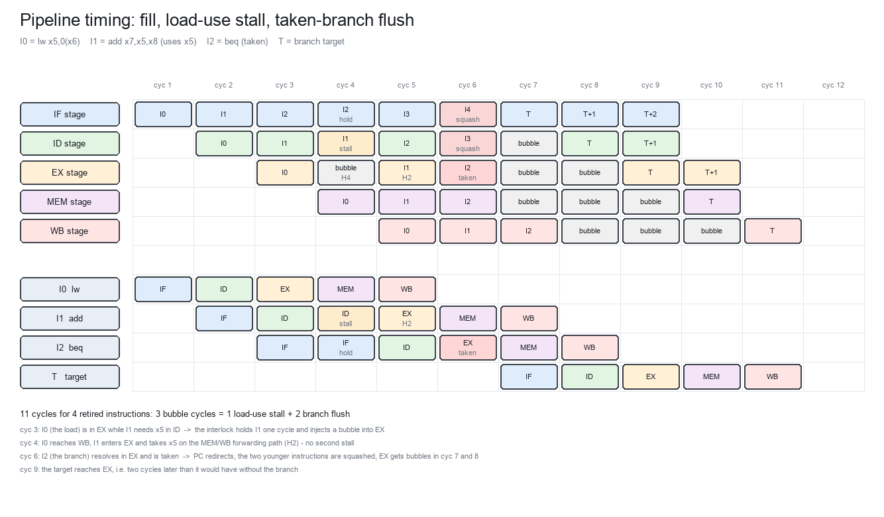

# 04 — 数据通路与控制通路（Phase 4）

> 本文档给出：逐级数据通路图、控制信号真值表、**复位到第一条指令的完整时序**、
> **ADD / LW / SW / BEQ / JAL 五条典型指令的逐拍数据通路分析**、冒险时序图、边界情形表。

---



*图 2：流水线时序（填充、Load-Use 停顿 1 拍、采纳分支冲刷 2 拍）。周期编号与
`tb/unit/tb_reset.v` 的断言、以及 `build/rtl_*.out` 的实测周期数一致。*

## 1. 数据通路详图

### 1.1 IF 级

```
              ┌──────────────── 重定向 (EX) ────────────────┐
              │                                             │
  RESET_PC ──►│  ┌─────────┐   pc_next    ┌──────────┐      │
              └─►│ next-PC │◄─────────────┤ +4 / 预测│◄─────┘
                 │  Mux    │              │  目标    │
                 └────┬────┘              └──────────┘
                      │ pc[31:0]
                 ┌────▼─────────────────────────────┐
                 │ PC 寄存器 (同步复位, halt 时保持) │
                 └────┬─────────────────────────────┘
                      ├──────────────► imem_addr[31:0]
                      │
                 ┌────▼─────────────┐
                 │  I-Mem (组合读)  │
                 └────┬─────────────┘
                      └──────────────► if_instr  ──► [IF/ID 寄存器]
   预测: 本版 PRED_TAKEN ≡ 0（静态预测不跳转），pred_target 不使用
```

控制点：`pc_sel`（`+4` / `redirect_target`）、`pc_en`（停顿/停机时保持）。

### 1.2 ID 级

```
 if_id_instr ──┬──► ┌──────────┐ ──► ctrl[23:0] ──► [ID/EX]
               ├──► │ decoder  │ ──► uses_rs1/uses_rs2 ──► 冒险单元
               │    └──────────┘
               ├──► ┌──────────┐ ──► imm[31:0] ──► [ID/EX]
               │    │ immgen   │
               │    └──────────┘
               │
               ├── rs1_addr ──┐
               ├── rs2_addr ──┤
               │         ┌────▼─────────────────────────┐
               │         │ regfile (2 读口 + 写穿透 H3) │
               │         └────┬──────────────┬──────────┘
               │              │ rs1_val      │ rs2_val      ──► [ID/EX]
               │              │
               └── 冒险单元: stall / redirect / 前递选择(在 EX 使用)
```

### 1.3 EX 级

```
                     ┌─ H1: ex_mem_alu ────────┐
                     ├─ H2: mem_wb_wdata ──────┤
                     ├─ 原值 id_ex_rs1_val ────┤
                     └────────►[fwd_a Mux]─────┴──► op_a ──┬──► ┌───────┐
                                                           │    │  ALU  │──► ex_alu
   id_ex_imm ──►[ALU_B Mux]──► op_b ───────────────────────┼──► └───────┘
   id_ex_rs2_val ──►(同上 fwd_b Mux)────────────────────────┤
                                                           │
   id_ex_pc ──►[ALU_A Mux]──────────────────────────────────┘
                                                           │
                                          ┌────────────────▼──────────────┐
                                          │ 分支比较器 (BR_OP)            │──► br_taken
                                          └───────────────────────────────┘
   id_ex_pc + imm 或 op_a + imm ──►[target Mux]──► actual_target
   actual_taken = br_taken | ctrl[JUMP]
   redirect = (actual_taken != pred_taken) | (actual_taken & (actual_target != pred_target))
   对齐检查 (仅当访存或跳转): misaligned ──► trap
```

### 1.4 MEM 级

```
   ex_mem_alu ──► dmem_addr[31:0]
   ex_mem_store_data, size, addr[1:0] ──► ┌───────────────┐ ──► dmem_wdata (lane 对齐)
                                          │ wstrb 生成     │ ──► dmem_wstrb[3:0]
                                          └───────────────┘
   ctrl[MEM_WE] ──► dmem_we        ctrl[MEM_RE] ──► dmem_re
   dmem_rdata ──► ┌───────────────────────────┐
                  │ 字节/半字提取 + 符号扩展   │──► load_data
                  └───────────────────────────┘
   wdata = (WB_SEL==MEM) ? load_data
         : (WB_SEL==PC4) ? ex_mem_pc + 4      // JAL/JALR 链接值
         :                 ex_mem_alu        ──► [MEM/WB]
```

### 1.5 WB 级

```
   mem_wb_rf_we ──┐
   mem_wb_rd_addr ┼──► regfile 写口 (写穿透旁路同拍对 ID 可见)
   mem_wb_wdata ──┘
   （WB 级无组合逻辑，写口直连 MEM/WB 寄存器）
```

---

## 2. 控制信号真值表

`X` = 无关（don't care）。`CTRL_*` 编码见 `03` §3。

| 指令 | ALU_OP | ALU_A | ALU_B | WB_SEL | RF_WE | MEM_RE | MEM_WE | SIZE | UNS | BRANCH/BR_OP | JUMP/JALR | 其它 |
|---|---|---|---|---|---|---|---|---|---|---|---|---|
| ADD/SUB/SLL/SLT/SLTU/XOR/SRL/SRA/OR/AND | 对应 | rs1 | rs2 | ALU | 1 | 0 | 0 | X | X | 0 | 0/0 | — |
| ADDI/SLTI/SLTIU/XORI/ORI/ANDI | 对应 | rs1 | imm | ALU | 1 | 0 | 0 | X | X | 0 | 0/0 | — |
| SLLI/SRLI/SRAI | 对应 | rs1 | imm | ALU | 1 | 0 | 0 | X | X | 0 | 0/0 | — |
| LB | ADD | rs1 | imm | MEM | 1 | 1 | 0 | B | 0 | 0 | 0/0 | — |
| LH | ADD | rs1 | imm | MEM | 1 | 1 | 0 | H | 0 | 0 | 0/0 | — |
| LW | ADD | rs1 | imm | MEM | 1 | 1 | 0 | W | 0 | 0 | 0/0 | — |
| LBU | ADD | rs1 | imm | MEM | 1 | 1 | 0 | B | 1 | 0 | 0/0 | — |
| LHU | ADD | rs1 | imm | MEM | 1 | 1 | 0 | H | 1 | 0 | 0/0 | — |
| SB | ADD | rs1 | imm | X | 0 | 0 | 1 | B | X | 0 | 0/0 | — |
| SH | ADD | rs1 | imm | X | 0 | 0 | 1 | H | X | 0 | 0/0 | — |
| SW | ADD | rs1 | imm | X | 0 | 0 | 1 | W | X | 0 | 0/0 | — |
| BEQ..BGEU | X | X | X | X | 0 | 0 | 0 | X | X | 1/funct3 | 0/0 | — |
| LUI | PASS_B | X | imm | ALU | 1 | 0 | 0 | X | X | 0 | 0/0 | — |
| AUIPC | ADD | **PC** | imm | ALU | 1 | 0 | 0 | X | X | 0 | 0/0 | — |
| JAL | X | X | X | **PC4** | 1 | 0 | 0 | X | X | 0 | **1/0** | — |
| JALR | ADD | rs1 | imm | **PC4** | 1 | 0 | 0 | X | X | 0 | **1/1** | — |
| FENCE/FENCE.I | X | X | X | X | 0 | 0 | 0 | X | X | 0 | 0/0 | `CTRL_FENCE=1`（纯观测） |
| ECALL | X | X | X | X | 0 | 0 | 0 | X | X | 0 | 0/0 | `CTRL_ECALL=1` |
| EBREAK | X | X | X | X | 0 | 0 | 0 | X | X | 0 | 0/0 | `CTRL_EBREAK=1` |
| 非法编码 | X | X | X | X | 0 | 0 | 0 | X | X | 0 | 0/0 | `CTRL_ILLEGAL=1` |

### 2.1 源寄存器使用标记（`uses_rs1/uses_rs2`，决定 H4 停顿与 H1/H2 前递是否相关）

| 指令类 | uses_rs1 | uses_rs2 | 说明 |
|---|---|---|---|
| R-type | 1 | 1 | |
| I-type ALU / Load | 1 | 0 | |
| JALR | 1 | 0 | 目标基址寄存器必须参与 load-use 停顿判定 |
| Store | 1 | **1** | rs2 是 store 数据，load→store 数据依赖必须能停顿 |
| Branch | 1 | 1 | |
| JAL / LUI / AUIPC | **0** | **0** | 避免立即数字段被误判为寄存器号而产生伪停顿 |

---

## 3. 复位到执行第一条指令的完整时序分析

约定：`reset` 在 `T0` 期间为高；`T1` 起为低。所有状态在**时钟上升沿**更新；
「T 拍某级的内容」指该周期内该流水线寄存器的值。

| 拍 | reset | PC（送给 I-Mem） | IF/ID | ID/EX | EX/MEM | MEM/WB | 该拍发生的事 |
|---|---|---|---|---|---|---|---|
| T0 | 1 | 无关（旧值） | 无效 | 无效 | 无效 | 无效 | **T0 上升沿**：`PC ← RESET_PC`；全部流水线寄存器 ← 气泡（`valid=0`，其余字段 0）；寄存器堆 ← 0（`RF_INIT_EN=1`）；`trap_o ← 0`；`halt/trap` 标志 ← 0 |
| T1 | 0 | `RESET_PC` | 无效 | 无效 | 无效 | 无效 | `imem_addr = RESET_PC`，组合读返回 I0。ID/EX/EX-MEM 全为空 → 无副作用。**T1 上升沿**：`IF/ID ← {valid=1, pc=RESET_PC, instr=I0}`；`PC ← RESET_PC+4` |
| T2 | 0 | `RESET_PC+4` | I0 | 无效 | 无效 | 无效 | ID 级译码 I0、读寄存器堆（写穿透生效）、生成立即数；冒险单元判定（ID/EX 无有效 Load ⇒ 不停顿）。**T2 上升沿**：`ID/EX ← I0 的 ctrl/操作数/imm/rd`；`IF/ID ← I1` |
| T3 | 0 | `RESET_PC+8` | I1 | **I0** | 无效 | 无效 | EX 执行 I0：前递 Mux → ALU；若是分支/跳转则解析并可能 `redirect`。**T3 上升沿**：`EX/MEM ← I0 结果`；`retire_valid_o` 在 T3 拉高（**I0 于此刻提交**） |
| T4 | 0 | `RESET_PC+12` | I2 | I1 | **I0** | 无效 | MEM 执行 I0：访存 / 对齐扩展 / 选择写回值。**T4 上升沿**：`MEM/WB ← 写回值` |
| T5 | 0 | `RESET_PC+16` | I3 | I2 | I1 | **I0** | WB：**T5 上升沿**把 I0 的结果写入寄存器堆。I0 全流程结束 |

**结论**：
- 复位后第 1 拍（T1）发出首次取指；**流水线填充深度 = 5 拍**；
- 第一条指令的体系结构效果（寄存器写）在 **T5 上升沿**可见；
- 第一条指令的**提交（retire）脉冲出现在 T3**（EX→MEM 边界）；
- 复位期间与 T1 均**不产生任何存储器写、寄存器写或 MMIO 副作用**（全部 `valid=0`）。

---

## 4. 典型指令的完整数据通路分析

以下 `n` 为该指令位于 IF 级的拍号；五级依次为 `n..n+4`。假设无冒险、地址已对齐。

### 4.1 `ADD x5, x6, x7`（0x007302B3）

| 级 | 拍 | 数据通路动作 | 控制信号 |
|---|---|---|---|
| IF | n | `imem_addr=A` → `if_instr`；`pc_next=A+4`；`pred_taken=0` | `pc_sel=+4` |
| ID | n+1 | 译码 → ctrl；`rs1_addr=6, rs2_addr=7, rd=5`；`rs1_val=rf[6]`, `rs2_val=rf[7]`（含 H3 写穿透） | `ALU_OP=ADD, ALU_A=rs1, ALU_B=rs2, WB_SEL=ALU, RF_WE=1`，其余 0 |
| EX | n+2 | `fwd_a/fwd_b` 选择（H1>H2>REGFILE）→ `op_a,op_b` → `ALU ADD` → `ex_alu`；分支逻辑不激活 | 无重定向 |
| MEM | n+3 | `mem_re=we=0` → 不访问存储器；`wdata = ex_mem_alu` | `WB_SEL=ALU` |
| WB | n+4 | `rf[5] ← wdata`（上升沿） | `mem_wb_rf_we=1` |
| 提交 | n+2 | `retire_valid_o` 拉高，`retire_pc_o=A` | — |

### 4.2 `LW x5, 8(x6)`（0x00832283）

| 级 | 拍 | 数据通路动作 | 控制信号/检查 |
|---|---|---|---|
| IF | n | 取指 | — |
| ID | n+1 | 译码；`rs1_addr=6, rd=5`；`rs2` 不使用；`imm=+8`；若 IF/ID 之后的指令用 x5 ⇒ **H4 停顿 1 拍** | `MEM_RE=1, SIZE=W, UNS=0, WB_SEL=MEM, RF_WE=1, ALU_OP=ADD, ALU_B=imm`；`uses_rs1=1` |
| EX | n+2 | `op_a = fwd(rs1)`；`addr = op_a + 8`；**对齐检查** `addr[1:0]==0`，否则陷阱原因 4 | 陷阱优先级高于提交 |
| MEM | n+3 | `dmem_addr=addr, dmem_re=1`；`dmem_rdata` 同拍有效 → `load_data = rdata`（W 宽度无移位/无扩展） | `wb_sel=MEM` |
| WB | n+4 | `rf[5] ← load_data` | — |
| 冒险 | — | 距离 1 使用者：停顿 1 拍后由 **H2（MEM/WB→EX）** 提供数据；距离 2、3 分别由 H1、H3 覆盖 | — |

### 4.3 `SW x7, 12(x8)`（0x0070A423）

| 级 | 拍 | 数据通路动作 | 控制信号/检查 |
|---|---|---|---|
| IF | n | 取指 | — |
| ID | n+1 | `rs1_addr=8, rs2_addr=7`；`imm=+12`；**`uses_rs2=1`** 使 load→store 数据依赖可被 H4 捕获 | `MEM_WE=1, SIZE=W, RF_WE=0, ALU_OP=ADD, ALU_B=imm` |
| EX | n+2 | `addr = fwd(rs1) + 12`；`store_data = fwd(rs2)`（H1/H2 修正）；**对齐检查** 否则陷阱原因 6；`wstrb=4'b1111` | 提交（`retire_valid_o`） |
| MEM | n+3 | `dmem_addr/dmem_wdata/dmem_wstrb/dmem_we` 有效 → **上升沿写入**；`dmem_re=0` | 不写寄存器堆 |
| WB | n+4 | 无动作（`rf_we=0`） | — |
| 说明 | — | store 的 rs2 在 EX 级一次性解析完毕 ⇒ **MEM 级不需要第二套前递网络**（决策 D6） | — |

### 4.4 `BEQ x1, x2, L`（funct3=0，不跳转预测）

| 级 | 拍 | 数据通路动作 | 控制信号/检查 |
|---|---|---|---|
| IF | n | 取指；`pred_taken=0`（静态预测不跳转） | — |
| ID | n+1 | `rs1_addr=1, rs2_addr=2`；`imm=B 型偏移`；ALU 控制无关（结果被忽略） | `BRANCH=1, BR_OP=0, RF_WE=0`；`uses_rs1=uses_rs2=1` |
| EX | n+2 | `op_a=fwd(x1), op_b=fwd(x2)` → `brcmp: eq`；`actual_taken = eq`；`actual_target = id_ex_pc + imm` | `redirect = eq`（因 `pred_taken=0`） |
| 结果 A：不跳转 | n+2 | `redirect=0`：PC 继续 `+4`，**零惩罚** | — |
| 结果 B：跳转 | n+2 | `redirect=1`：**T(n+2) 上升沿** `PC ← actual_target`；IF/ID、ID/EX ← 气泡 | **2 拍惩罚**（见 §5.2） |
| MEM/WB | n+3/n+4 | 无副作用（`rf_we=0`） | 提交仍发生在 n+2（EX→MEM） |

### 4.5 `JAL x1, L`（链接值 = PC+4）

| 级 | 拍 | 数据通路动作 | 控制信号 |
|---|---|---|---|
| IF | n | 取指（静态预测不跳转 ⇒ 顺序取 PC+4） | — |
| ID | n+1 | 译码；`rd=1`；`imm=J 型偏移`；**`uses_rs1=uses_rs2=0`**（立即数字段不得被当作寄存器号） | `JUMP=1, JALR=0, RF_WE=1, WB_SEL=PC4` |
| EX | n+2 | `actual_taken=1`；`actual_target = id_ex_pc + imm`；`redirect=1`（预测错误）→ 冲刷 IF/ID、ID/EX，`PC ← target` | 2 拍惩罚 |
| MEM | n+3 | `wdata = ex_mem_pc + 4`（**链接值在 MEM 级生成**，`ex_mem_pc` 因此是功能字段） | `WB_SEL=PC4` |
| WB | n+4 | `rf[1] ← PC+4` | `rf_we=1` |

> `JALR x1, x2, 0` 差异：`JUMP=1, JALR=1`，`uses_rs1=1`（参与 H4 停顿与 H1/H2 前递），
> `actual_target = (fwd(x2) + 0) & ~32'd1`；目标 `[1:0] != 0` ⇒ 陷阱原因 0。

---

## 5. 冒险时序图

### 5.1 Load-Use 停顿（1 拍）

指令：`I0 = LW x5,0(x6)`；`I1 = ADD x7,x5,x8`（用 x5）；`I2`、`I3` 为后续指令。

| 拍 | T1 | T2 | T3 | T4 | T5 | T6 | T7 |
|---|---|---|---|---|---|---|---|
| I0 (LW) | IF | ID | EX | MEM | WB | — | — |
| I1 (ADD) | — | IF | ID | **ID（保持）** | EX | MEM | WB |
| I2 | — | — | IF | **IF（保持）** | IF | ID | EX |
| EX 级 | 空 | 空 | I0 | **气泡（stall 注入）** | I1 | I2 | I3 |

T3 判定 `stall=1` ⇒ T3 上升沿：PC 保持、IF/ID 保持（I1 不前进）、ID/EX ← 气泡。
T5：I1 在 EX，I0 在 WB ⇒ **H2 前递**提供 x5。总惩罚 **1 拍**。

### 5.2 分支采纳冲刷（2 拍）

| 拍 | Tn | Tn+1 | Tn+2 | Tn+3 |
|---|---|---|---|---|
| B（分支，采纳） | **EX** | MEM | WB | — |
| B+1（错误路径） | ID | **抹除** | — | — |
| B+2（错误路径） | IF | **抹除** | — | — |
| 目标指令 T | — | IF | ID | **EX** |
| EX 级 | B | 气泡 | 气泡 | T |

Tn 判定 `redirect=1` ⇒ Tn 上升沿：`PC ← target`、IF/ID/ID/EX ← 气泡。
T 进入 EX 的时刻由 Tn+1 推迟到 Tn+3 ⇒ 总惩罚 **2 拍**。

### 5.3 三条前递路径与一个互锁的覆盖关系（距离定义：使用者 − 生产者）

| 距离 | 情形 | 覆盖机制 |
|---|---|---|
| 1 | 生产者在 EX/MEM | **H1**（EX/MEM→EX 前递） |
| 2 | 生产者在 MEM/WB | **H2**（MEM/WB→EX 前递） |
| 3 | 生产者在 WB，使用者在 ID 同拍读寄存器堆 | **H3**（寄存器堆写穿透） |
| ≥4 | 生产者已退休 | 寄存器堆直接读 |
| 1（Load） | 生产者是 Load 且在 EX | **H4**（停顿 1 拍）→ 退化为距离 2 → H2 |

---

## 6. 边界情形清单（实现与验证都必须覆盖）

| # | 情形 | 期望行为 |
|---|---|---|
| E1 | `x0` 作目的寄存器（任意指令） | 不写、不产生前递命中（`rd!=0` 门控） |
| E2 | `x0` 作源寄存器 | 恒读 0；前递命中被 `rd!=0` 门控排除 |
| E3 | `LW x5,0(x6)` 紧接 `SW x5,...` / `BEQ x5,...` | H4 停顿（`uses_rs2=1`） |
| E4 | `LW` 紧接 `LUI/JAL`（rs1/rs2 字段是立即数位） | **不得停顿**（`uses_*=0`） |
| E5 | 移位量 0 / 31（`slli/srli/srai/sll/srl/sra`） | 正确；`SRA` 对负数保持符号 |
| E6 | `SLT/SLTI` vs `SLTU/SLTIU` 在 `0x8000_0000` 等值上 | 有符号/无符号结果不同且正确 |
| E7 | `LB/LBU`、`LH/LHU` 在 `0x7F/0x80/0x7FFF/0x8000` | 符号/零扩展正确 |
| E8 | 字节/半字写只改目标字节 | 相邻字节不变（由 `wstrb` 保证） |
| E9 | 地址回绕 `0xFFFF_FFFF + 4` | 32 位模运算，无异常 |
| E10 | `JAL` 链接值 | 恒为 `PC_of_jump + 4`（与目标是否回绕无关） |
| E11 | `JALR` 目标 bit0 清零 | `& ~32'd1` |
| E12 | 分支/JAL 目标 `[1:0] != 0` | 陷阱原因 0，且**不产生**错误取指副作用 |
| E13 | 非对齐 `LW/SW/LH/SH` | 陷阱原因 4 / 6，**不访问存储器** |
| E14 | 分支紧跟在 Load 后且比较该 Load 结果 | H4 停顿（分支的 `uses_rs1/rs2=1`） |
| E15 | 连续三条互相依赖的 ALU 指令 | H1、H2 分别命中，结果正确 |
| E16 | 生产者在使用者前 3 条 | H3 写穿透命中（最易漏，必须显式测） |
| E17 | 非法编码（`0x0000_0000`、CSR 指令 `csrrs`） | 陷阱原因 2，不写任何状态 |
| E18 | 停机指令后仍有在途指令 | 年轻指令被抹除，不产生内存/寄存器副作用 |
| E19 | 复位后立即停机 | 无任何副作用，`retire` 计数为 0 |
| E20 | 分支在 `0xFFFF_FFFC`（回绕） | 目标 32 位模运算 |

---

## 7. 位宽与常量约定

| 项 | 约定 |
|---|---|
| 操作数/地址 | 32 bit，全部算术模 2³² |
| 立即数 | 生成即符号扩展为 32 bit（U 型为高 20 位 + 低 12 位 0） |
| 分支/跳转目标 | 32 bit，B/J 立即数 bit0 恒 0 |
| 移位量 | `op_b[4:0]` |
| 字节车道 | `dmem_wdata`/`dmem_rdata` 与 `addr[1:0]` 对齐；`wstrb = f(size, addr[1:0])` |
| 寄存器号 | 5 bit；`rd != 0` 才允许写/前递 |
| 陷阱原因码 | 4 bit（0/2/3/4/6/11） |

---

---

## 8. 与实现的一致性

本文档描述的数据通路与控制已按原样实现并通过验证：

- 复位到首指令的 5 拍时序：由 `tb/unit/tb_reset.v` 断言（第 3 拍退休、第 5 拍写回）；
- 五条典型指令的逐拍行为：由差分测试覆盖（每条指令都与独立 ISS 逐字一致）；
- 停顿/冲刷优先级与表格：由 `tb/unit/tb_hazard.v` 与 `hazard_mixed.S` 覆盖；
- 唯一与本文档不同的实现细节：EX/MEM 级不携带整条控制总线，而是**命名的分控制寄存器**
  （见 `03` §2.3 与 `07` §7 第 15 项），行为语义不变。
